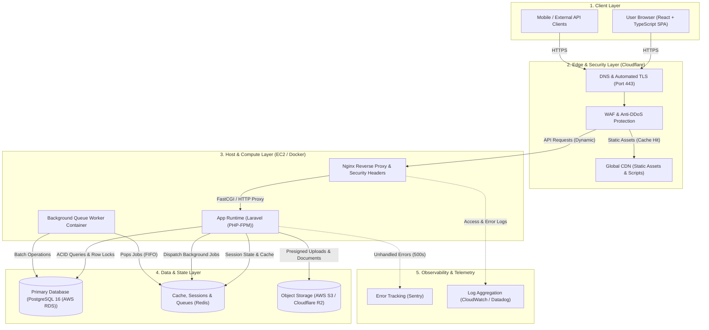

# System Architecture & Infrastructure Blueprint

> **Application**: Doraemon-s-Pocket  
> **Framework**: Laravel (PHP-FPM)  
> **Frontend**: React + TypeScript SPA  
> **Primary Database**: PostgreSQL 16 (AWS RDS)  
> **Status**: Production Reference Architecture  
> **Generated**: 2026-10-11  

---

## 1. Executive Summary

Doraemon-s-Pocket is structured with a decoupled or unified architecture where **Laravel (PHP-FPM)** serves the backend API and **React + TypeScript SPA** provides the user interface. State and transactions are persisted in **PostgreSQL 16 (AWS RDS)**, in-memory caching and background queues are powered by **Redis**, and **Cloudflare** guards the public edge.

This document serves as the high-level technical contract and infrastructure roadmap for engineering teams and clients.

---

## 2. End-to-End Infrastructure Architecture

---

## 3. Layer Breakdown & Roles

| Layer | Component | Technical & Business Purpose |
| :--- | :--- | :--- |
| **Edge** | **Cloudflare** | DNS resolution, edge TLS termination, DDoS mitigation, WAF rule enforcement, and static asset caching. |
| **Reverse Proxy** | **Nginx** | Terminating origin traffic, setting HTTP security headers (CSP, HSTS, X-Frame-Options), and enforcing IP rate limiting. |
| **Backend** | **Laravel (PHP-FPM)** | Request authentication, server-side RBAC validation, business transaction processing, and API JSON responses. |
| **Worker** | **Queue Worker** | Asynchronous execution of long-running tasks (bulk imports, reports, emails) without blocking user requests. |
| **Database** | **PostgreSQL 16 (AWS RDS)** | Transactional source of truth with foreign key constraints, pessimistic row-locking, and automated snapshots. |
| **Cache/Queue** | **Redis** | Sub-millisecond in-memory cache, session store, and background queue broker. |
| **Storage** | **AWS S3 / R2** | Private object storage for uploaded files and generated exports via presigned URLs. |
| **Monitoring** | **Sentry** | Real-time unhandled exception tracking, performance tracing, and alert delivery. |

---

## 4. Message Broker Strategy: "Do We Need Kafka?"

* **The Reality**: Standard business applications handle tens to hundreds of transactions per second. A single lightweight **Redis** instance comfortably handles **5,000 to 15,000 jobs per second**.
* **Kafka Trade-offs**: Introducing Apache Kafka requires distributed KRaft/ZooKeeper coordination, partition management, and continuous devops overhead. It is intended for millions of events per second across hundreds of microservices.
* **Decision**: Keep **Redis** (or managed AWS SQS if multi-service decoupling is required). Avoid premature adoption of Kafka.

---

## 5. Infrastructure Scaling Roadmap

* **Tier 1: Production Standard (0 – 50k Users | ~$50 – $120/mo)**
  - Cloudflare Edge (DNS, WAF, CDN)
  - Single AWS EC2 (`t4g.small` / `t4g.medium`) running Docker Compose (`nginx`, `app`, `worker`)
  - Managed AWS RDS (PostgreSQL 16 (AWS RDS)) + Managed Redis
  - AWS S3 or Cloudflare R2 for files
* **Tier 2: High Availability (50k – 500k Users | ~$300 – $700/mo)**
  - AWS Application Load Balancer (ALB) across 2+ EC2 instances
  - Database Read Replica for reporting and analytics queries
  - Dedicated EC2 queue worker instance
* **Tier 3: Enterprise Distributed (500k+ Users)**
  - Container orchestration (AWS ECS / EKS)
  - Managed message streaming (AWS SQS / Kinesis)

---

## 6. Pre-Production Verification Checklist

- [ ] **Edge Active**: Cloudflare proxy enabled with Full (Strict) SSL.
- [ ] **Throttling Enforced**: Sensitive endpoints (/login, exports) protected by rate limiters.
- [ ] **Database Private**: DB and Redis deployed in private VPC subnets with no public IPs.
- [ ] **Backups Scheduled**: Automated daily RDS snapshots with point-in-time recovery.
- [ ] **Telemetry Tested**: Sentry exception tracking verified with a synthetic test event.
- [ ] **Readiness Audit Passed**: Ran `~/.gemini/config/skills/production-readiness/scripts/audit.sh` with 0 release blockers.
